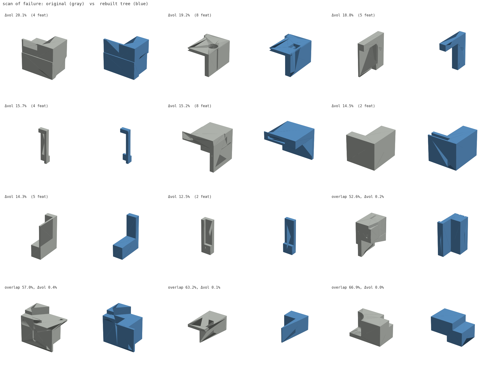

# MFInstSeg benchmark — full-part reconstruction on 9,375 public models

**Date:** 2026-11-17 · **Code:** commit `f571c9b` · **Dataset:** the MFInstSeg test split
(9,375 STEP models) from [AAGNet](https://github.com/whjdark/AAGNet), using the exact id
list published by [quiddity](https://github.com/pzfreo/quiddity)
(`tools/as_compare/test_ids.txt`) so results are split-identical. · **Hardware:** one AWS
c7a.16xlarge (64 vCPU), 64 workers, 180 s per-model timeout; ~3.2 h wall for the full split.

## What is measured

featuretree's `step_recognize.recognize()` is asked to recover an **editable feature tree**
(sketches, pads, pockets) for each model. The tree is then re-emitted through the geometry
kernel and compared against the input. A model counts as **VERIFIED** only if the rebuilt
solid passes *all four* gates at once:

1. volume within **0.5 %** of the input,
2. rotation-tolerant bounding extents within tolerance,
3. two-sided overlap (sampled IoU) above the acceptance threshold — this catches
   *compensating errors*, where over-cut and uncut material cancel in a volume difference,
4. the rebuilt result is **one closed body**, like its input.

This is an all-or-nothing, whole-part claim: one slightly-wrong pocket in a 9-feature part
fails the entire model. There is deliberately no partial credit, because "the whole tree is
right" is the claim that matters for editing the part downstream.

## Headline results

| | |
|---|---|
| models attempted | 9,375 (100 % of split) |
| completed (no crash/timeout) | 9,359 — **99.83 %** (1 crash, 15 timeouts) |
| **VERIFIED** (all four gates) | **2,301 — 24.5 %** |
| reconstruction on VERIFIED | median \|Δvol\| 0.09 %, p95 0.39 % |
| per-model wall time | median 70 s, p95 119 s, max 242 s (one EPYC core/model) |
| features per recovered tree | median 9, p95 18 |

## Where the other 75 % goes

Nearly every model yields a *sane* tree; the gates then attribute the misses:

| rejection | models | share of completed |
|---|---|---|
| volume gate (> 0.5 %) | 4,928 | 52.7 % |
| overlap gate (volume+extents pass, IoU below threshold) | 2,057 | 22.0 % |
| extents gate | 66 | 0.7 % |
| closed-body gate | 7 | 0.1 % |

The volume misses are overwhelmingly *near*: 47.6 % of all models rebuild within 0.5 %
volume, 64.7 % within 1 %, **98.1 % within 5 %**. Catastrophic misses (> 10 %) are 0.3 %.
Of the overlap-gate rejections, 781 sit at ≥ 99 % overlap and another 1,109 at 96–99 % —
a slightly-wrong feature, not a wrong part. (Relaxing the overlap threshold to 99 % would
read 32.9 % VERIFIED; we don't, but the sensitivity is worth knowing.)

## What the worst failures look like

The twelve worst failures of the entire run — the eight largest volume misses and the four
lowest overlaps — original (gray) beside the rebuilt tree (blue), same camera and scale per
pair:



Three readings. Even at the tail of the distribution most reconstructions are recognizably
the same part with one wrong feature. Slanted faces recur in the volume misses: large angled
cutaways come back as square material (the slanted_through_step deficit made visible). And
the overlap gate is catching real impostors: the 52.6% and 63.2% pairs match volume within
0.2% yet are different shapes — false accepts under a volume-only metric. Two pairs (the
18.8% and 63.2% reconstructions) show a distinct wrong-axis failure mode: the recognizer read
the part along the wrong base profile and built a plausible tree for a different part.

## What drives failure: complexity, then the step family

**Feature-count decay.** VERIFIED is a conjunction over every feature, so the rate decays
with the number of distinct feature classes in the part — consistent with a roughly
constant per-feature success rate:

| distinct feature classes | models | VERIFIED |
|---|---|---|
| 1 | 27 | 70.4 % |
| 2 | 272 | 56.2 % |
| 3 | 987 | 43.2 % |
| 4 | 1,850 | 33.8 % |
| 5 | 1,798 | 26.2 % |
| 6 | 1,791 | 17.1 % |
| 7 | 1,410 | 13.3 % |
| 8+ | 1,224 | 9.2 % |

**Per-class marginal rates** (share of models *containing* that class which verify;
dataset mean 24.6 %). The weakest classes are the **step family** — partial-depth cuts
open to the stock boundary, and the slanted-wall variant — not fillets or chamfers, which
sit at the dataset average (taper handles chamfers; small rounds stay within tolerance):

| worst classes | VERIFIED | | best classes | VERIFIED |
|---|---|---|---|---|
| triangular_blind_step | 7.5 % | | rectangular_through_slot | 38.1 % |
| circular_blind_step | 11.7 % | | rectangular_through_step | 31.1 % |
| slanted_through_step | 16.7 % | | rectangular_passage | 28.6 % |
| rectangular_blind_step | 18.1 % | | circular_through_slot | 28.0 % |
| 2sides_through_step | 18.2 % | | round (fillet) | 24.9 % |
| | | | chamfer | 24.3 % |

(Marginal rates are confounded with complexity — rare classes co-occur with many others —
but the step family's deficit is far larger than that effect.)

## Comparison with quiddity — different contest, same split

[quiddity](https://github.com/pzfreo/quiddity) reports **77 % recall, 14 % false positives,
73 ms median** on this split. Those numbers are *not comparable* to ours and are not meant
to be beaten here: quiddity labels machining features on B-rep faces (analysis records with
face accounting); featuretree rebuilds the entire part as an editable tree and only claims
success when the re-emitted solid survives the four gates — a compound bar roughly three
orders of magnitude slower to evaluate. The honest common ground is **robustness**
(quiddity: no crashes; featuretree: 99.83 % completion on the same arbitrary geometry) and
**refusal honesty**: both systems say what they could not do rather than silently
best-effort. To our knowledge 24.5 % is the first published *full-reconstruction* rate on
this split; there is no prior number on this metric to compare against.

## Known defects surfaced by the run

- **1 crash**: `20221121_154648_16121`, `IndexError: list index out of range` (repro kept).
- **15 timeouts** at 180 s (0.16 %) — ids recorded in the raw results.
- The **0.5–1 % volume band** (1,604 models) and the **≥ 99 % overlap band** (781 models)
  are the two cheapest places to raise the headline number with real recognition fixes
  (not gate relaxation): together they bound a plausible ~34 % near-term ceiling.
- The **blind/slanted step family** is a vocabulary gap: a partial-depth cut anchored to
  the stock edge. Expressing it should disproportionately help, since steps appear in
  ~29 % of models and drag every part they touch.

## Reproducing

```
# one worker (stride/offset parallelism; resume-safe, appends JSONL)
FEATURETREE=/path/to/featuretree python -I benchmarks/mfeval_worker.py \
    test_ids.txt steps/ out.jsonl 0 1 180
python -I benchmarks/mfeval_score.py out*.jsonl
```

Raw per-model records (id, status, verdict, reason, Δvol, feature count, wall time) for
this run: `mfeval_full_{0..7}.jsonl`, 9,375 rows.
